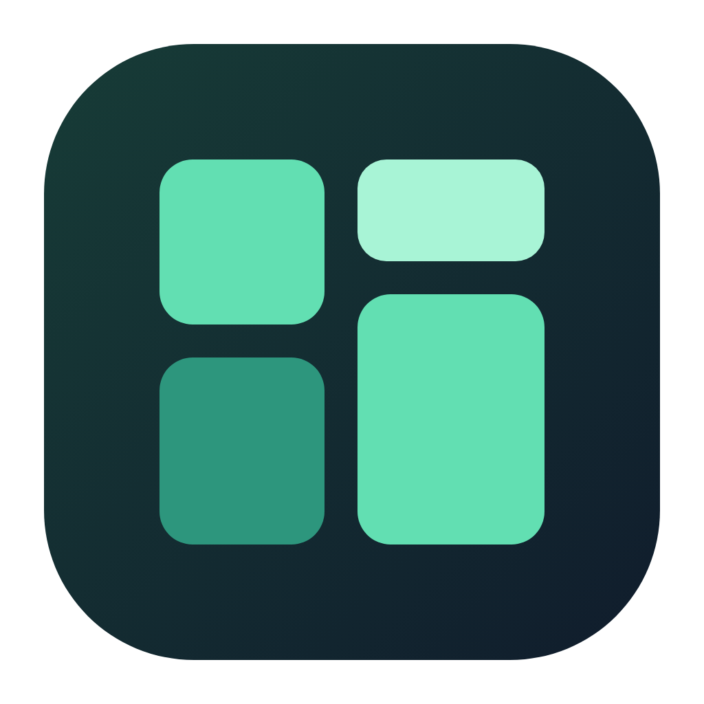

<p align="center">
  
</p>


<p align="center">
  简体中文 · <a href="README.en.md">English</a>
</p>

<p align="center">
  <a href="https://github.com/likaia/mise_gui/releases"></a>
  <a href="https://github.com/likaia/mise_gui/releases"></a>
  <a href="LICENSE.txt"></a>
  <a href="https://github.com/likaia/mise_gui/releases"></a>
</p>

# DevWorkbench

本地开发工具工作台：统一识别工具、分类展示、查看详情和快速打开，并保留 mise 的运行时版本管理。

## 此 fork：工具工作台

基于 [likaia/mise_gui](https://github.com/likaia/mise_gui)，保留 MIT 协议与原作者署名。此分支先适配 macOS 上现有的分类目录和版本管理，使用项目固定的 Flutter 3.47.7；首次启动不会迁移 SDK 或改变全局默认版本。

- 新增“开发工具”工作台，分类识别运行时、包管理器、移动开发、IDE 和网络工具；支持搜索、应用打开、目录定位和路径复制，详情可跳转相应 mise 工具链。
- “mise 工具链”页面，识别 Java、Node.js、Python、Go、Rust、Flutter；显示真实目录、注册路径和作用域，Dart 跟随 Flutter。
- 分类安装与全局/项目切换分开，原工具页也接入相同策略。首期保护已有目录，卸载和批量升级暂不开放。
- 移除 GUI 自身的更新检测、提示与 mise 本体升级入口；开发工具的远端版本查询和分类安装继续保留。
- 应用配置与历史放在 `$HOME/Developer/toolchains/mise-gui/`。全局配置、缓存和运行时沿用已有 mise 环境。
- [工具工作台设计与边界](docs/dev-workbench.md) · [分类安装策略](docs/classified-toolchains.md) · [实际 Flutter 页面预览](docs/design/README.md)
- [代码与上游 Issues 检查记录](docs/bug-audit-2026-10-18.md)

```sh
mise exec -- flutter pub get
mise exec -- flutter run -d macos
```

验证使用 `flutter analyze`、`flutter test`、`dart run tool/check_environment.dart`、`dart run tool/check_local_tools.dart`。本机 macOS 构建采用 ad-hoc 签名；公开分发前另行配置签名和公证。

本地 Release 构建使用 `bash scripts/build_local_macos.sh`，构建后刷新内嵌框架及应用的临时签名并进行校验。

以下保留上游项目介绍，部分原版操作在此分支受到首期策略保护。


## 项目简介

Mise GUI 是一个基于 Flutter 的跨平台桌面应用，为 [mise](https://mise.jdx.dev/) 提供更直观的本地环境管理体验。它会读取真实的 mise CLI 状态，把系统信息、已安装工具、项目级版本覆盖、全局配置和最近操作集中到一起进行快速便捷的管理。

本项目适合经常在多语言、多项目之间切换的开发者：你不需要反复执行 `mise current`、`mise ls`、`mise outdated` 或打开多个 `mise.toml` 文件，就能快速判断当前有哪些项目覆盖了全局版本。


## 界面预览


### 工具版本

按工具查看当前版本和最新版本，进入详情后可以加载远端版本、切换版本、升级或卸载。


### 安装新工具

安装流程会先读取远端可选版本，确认后进入命令预览，不会直接执行不可见操作。


### 项目覆盖

你可以添加多个扫描目录，应用会递归检查项目配置，并把覆盖全局默认版本的项目单独展示出来。


### 配置管理

配置页把全局配置和项目配置放在同一个上下文里，编辑 TOML 前后可以查看差异，减少误改风险。


## 开始使用

前往[releases](https://github.com/likaia/mise_gui/releases)页下载符合你操作系统的最新版本，软件成功安装后，如果当前机器没有安装 mise，应用会进入引导页并给出推荐安装命令：

```bash
# macOS
brew install mise

# Windows
winget install jdx.mise

# Linux
curl https://mise.run | sh
```


## 本地开发

```bash
git clone https://github.com/likaia/mise_gui.git
cd mise_gui

flutter pub get
flutter run -d macos
```

其他桌面平台可以替换运行目标：

```bash
flutter run -d linux
flutter run -d windows
```


## 项目结构

```text
lib/
  app/                  # 应用启动、路由、主题和外壳
  features/
    dashboard/          # 环境总览
    tools/              # 工具版本、安装、升级、卸载
    projects/           # 扫描目录和项目覆盖
    config/             # 全局与项目配置管理
  repositories/         # 页面数据聚合
  services/             # mise CLI、配置、历史、更新等底层服务
  shared/ui/            # 通用面板、状态、对话框和预览组件
scripts/                # macOS 打包脚本
docs/                   # README 截图素材
```


## License

本项目使用MIT作为开源协议，详情请移步： [LICENSE.txt](LICENSE.txt)。
