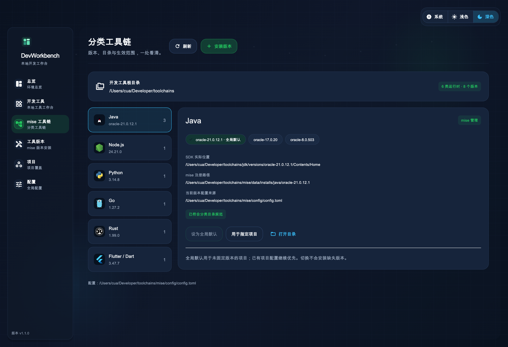
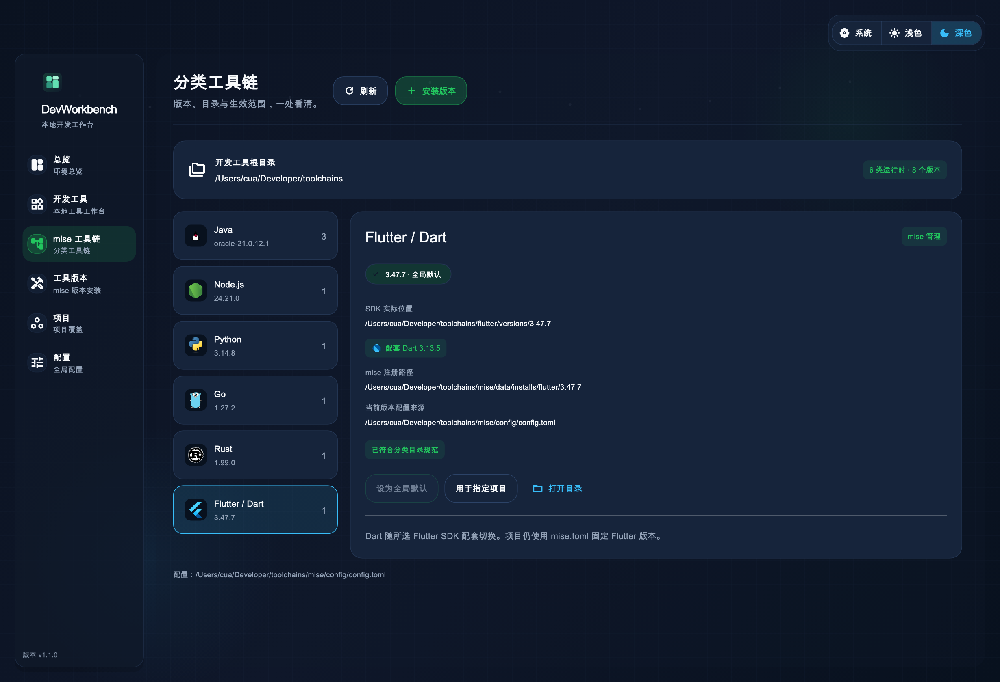

# 界面预览与验证

这些图片由实际 Flutter 页面和应用外壳渲染，使用本机版本配置的测试快照；它们不是运行中的 GUI 截屏。真实应用启动时通过 mise 查询版本和目录，不读取该快照。

## 分类工具链



## Flutter 与配套 Dart



## 重现预览

普通界面测试：

```sh
flutter test test/toolchains_page_test.dart
```

生成图片时，通过环境变量传入本机中文字体和当前 Flutter SDK 自带的 Material Icons 字体：

```sh
MISE_GUI_RENDER_PREVIEW=1 \
MISE_GUI_PREVIEW_CJK_FONT="<本机 PingFang.ttc 路径>" \
MISE_GUI_PREVIEW_MATERIAL_FONT="$(mise where flutter)/bin/cache/artifacts/material_fonts/MaterialIcons-Regular.otf" \
flutter test test/toolchains_page_test.dart
```

字体仅在本机加载，不复制到仓库。

## 首期验证记录

2026-10-18，macOS ARM64，Flutter 3.47.7 / Dart 3.13.5：

- 真实登录 Shell 与分类目录查询通过，发现 6 类运行时、8 个已安装版本。
- 静态分析、64 项测试及 macOS Debug / Release 构建通过。测试包含真实 mise 在隔离 HOME、配置和数据目录中的注册、全局切换、项目切换、未知配置段保留，以及安装失败时对并发锁文件的保护。
- 安装流程验证了命令计划、目标目录保护、软链接越界保护；没有为测试下载或增加新的 SDK 版本。
- 上游作者的签名团队已移除，本机采用 ad-hoc 签名。公开分发和公证需另外配置签名证书。
- 本地 Release 入口为 `bash scripts/build_local_macos.sh`，构建后按由内到外的顺序刷新 App.framework 与应用签名，避免增量构建的旧签名造成校验失败。
- 工具图标使用官方素材，来源、校验值与版权说明见 [素材目录](../../assets/toolchains/README.md)。

应用源码的首期适配针对 macOS；Linux、Windows 构建没有在本机验证。
