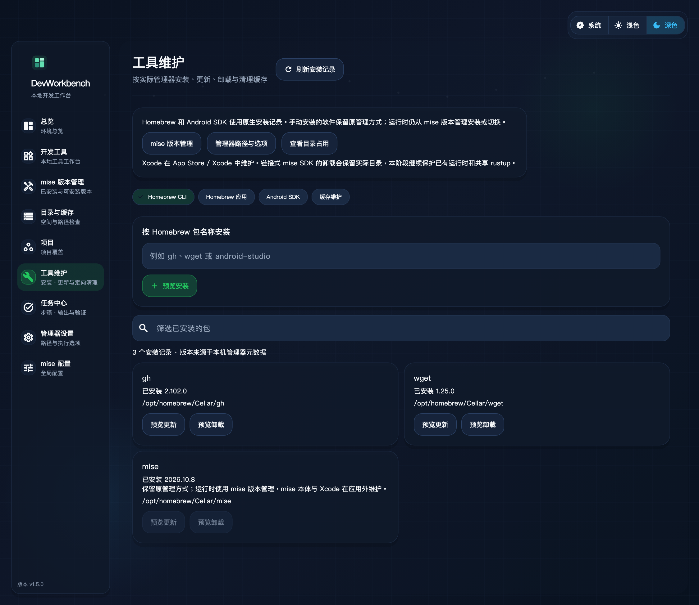
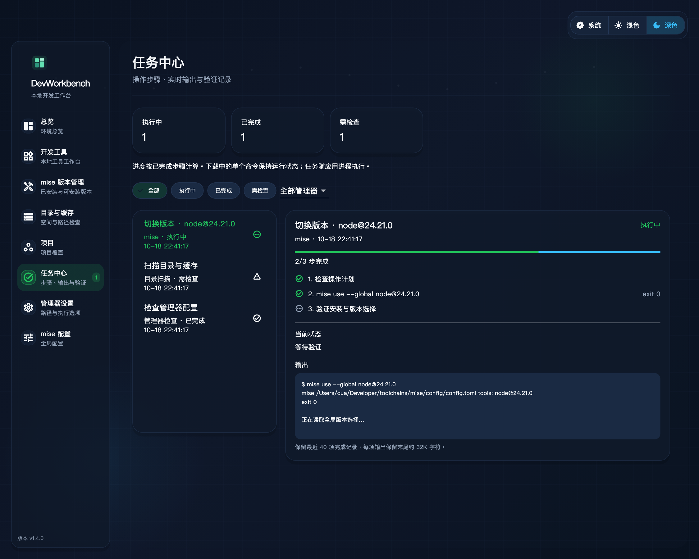
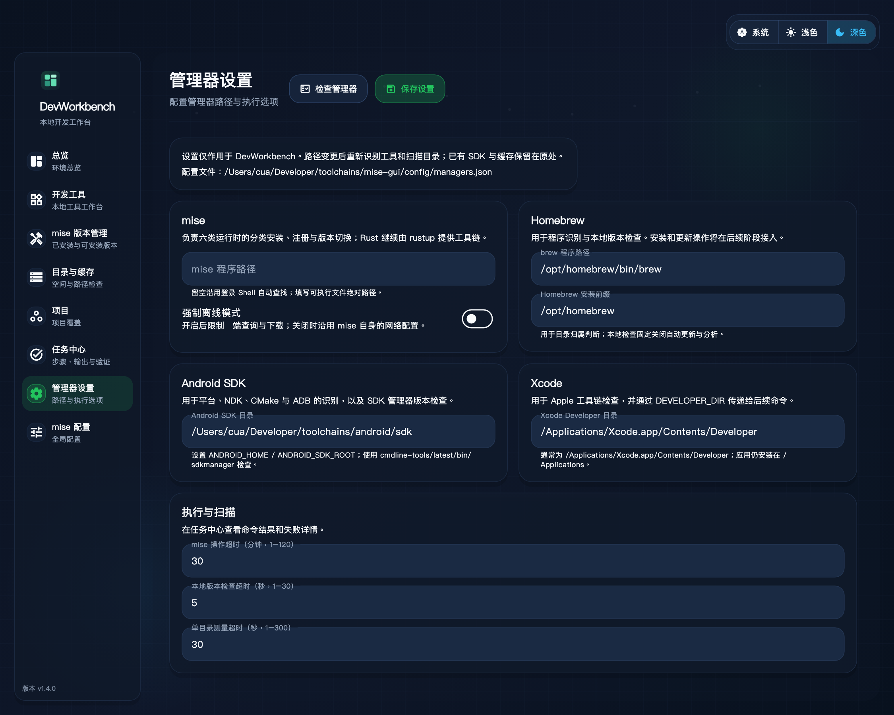
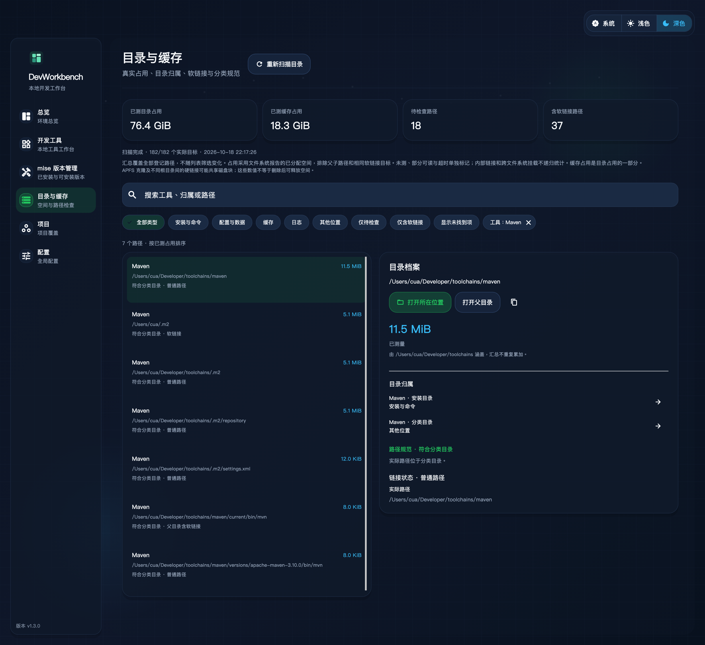
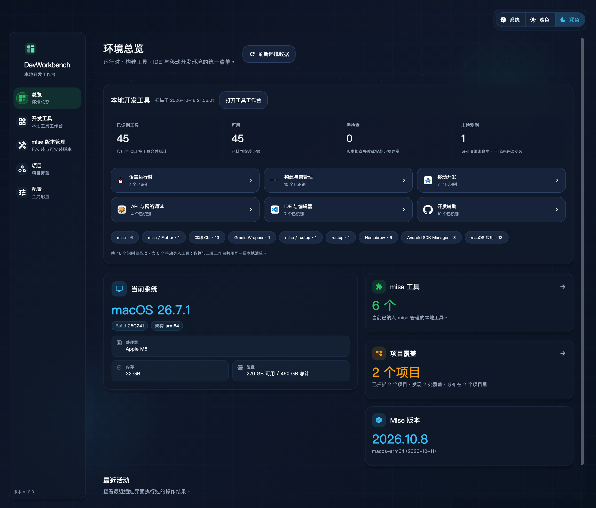
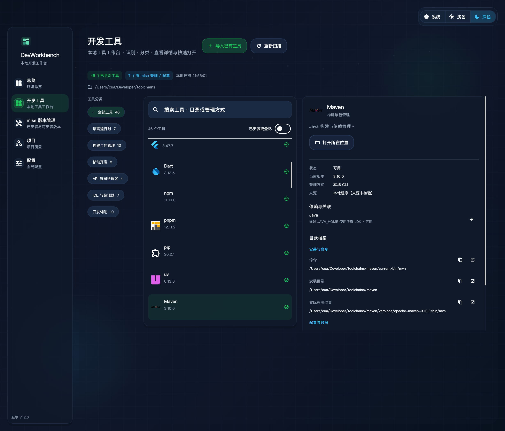
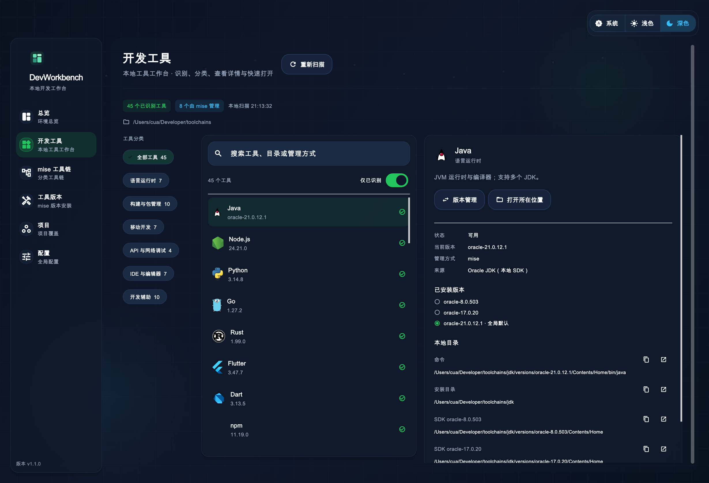
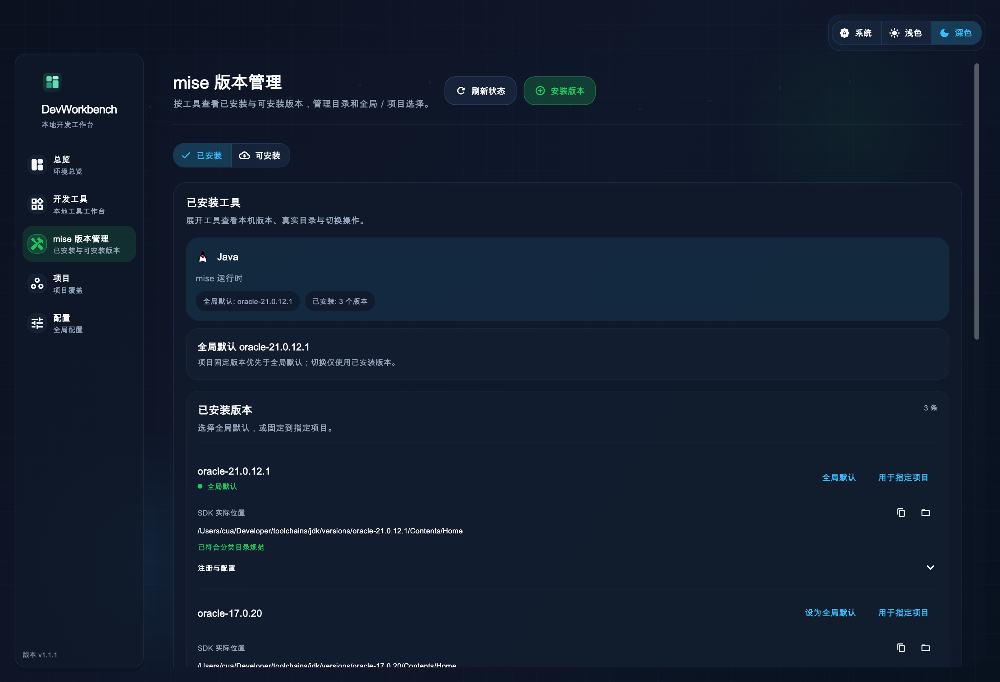

# 界面预览与验证

这些图片由实际 Flutter 页面和应用外壳渲染，使用本机版本配置的测试快照；它们不是运行中的 GUI 截屏。真实应用通过本地识别服务和 mise 查询版本、目录，不读取测试快照。

## 工具维护



由实际 Flutter 页面渲染，使用隔离的安装记录测试场景，展示原生包的预览操作与受保护的 mise 条目。设置 `DEVWORKBENCH_RENDER_MAINTENANCE=1`，结合下方中文及 Material Icons 字体变量，运行 `flutter test test/maintenance_page_test.dart` 可重现。

## 任务中心与管理器设置





这两图由真实 Flutter 页面渲染，注入进行中、已完成和需检查的界面测试场景；示例任务不写入用户记录。设置 `DEVWORKBENCH_RENDER_TASKS=1`，结合下方中文与 Material Icons 字体变量，运行 `flutter test test/task_settings_page_test.dart` 可重现。

## 目录与缓存



由真实 Flutter 页面渲染，本机只读测量结果注入视图；预览按 Maven 归属筛选，顶部仍是全部登记路径的汇总。使用下方字体环境变量并设置 `DEVWORKBENCH_RENDER_STORAGE=1`，运行 `flutter test test/storage_page_test.dart` 可重现。

## 统一总览与工具档案





设置 `DEVWORKBENCH_RENDER_PREVIEW=1` 运行 `test/workbench_overview_test.dart` 可生成以上两图，字体环境变量与下方工作台预览相同。该模式只读查询本机工具、系统与现有项目信息；普通测试使用隔离快照。

## DevWorkbench 工具工作台



工作台图由实际 Flutter 页面渲染。设置 `DEVWORKBENCH_RENDER_PREVIEW=1` 时会先只读扫描本机工具，再把真实清单注入页面生成此图；普通测试使用隔离的固定快照，不运行本机探测。重现方式：

```sh
DEVWORKBENCH_RENDER_PREVIEW=1 \
MISE_GUI_PREVIEW_CJK_FONT="<本机中文字体路径>" \
MISE_GUI_PREVIEW_MATERIAL_FONT="$(mise where flutter)/bin/cache/artifacts/material_fonts/MaterialIcons-Regular.otf" \
flutter test test/local_tools_page_test.dart
```

## mise 版本管理



## Flutter 与配套 Dart


## 重现预览

普通界面测试：

```sh
flutter test test/tools_version_management_test.dart
```

生成图片时，通过环境变量传入本机中文字体和当前 Flutter SDK 自带的 Material Icons 字体：

```sh
MISE_GUI_RENDER_PREVIEW=1 \
MISE_GUI_PREVIEW_CJK_FONT="<本机 PingFang.ttc 路径>" \
MISE_GUI_PREVIEW_MATERIAL_FONT="$(mise where flutter)/bin/cache/artifacts/material_fonts/MaterialIcons-Regular.otf" \
flutter test test/tools_version_management_test.dart
```

字体仅在本机加载，不复制到仓库。

## 工具维护验证

2026-10-18，DevWorkbench 1.5.0，macOS ARM64：

- 171 项测试通过，包含 Homebrew 原生计划、依赖与固定版本保护、Android 组件及 AVD 引用保护、失效预览、安装结果回读、任务锁、缓存范围与执行前改链保护、原生超时、确认／取消和窄窗口。两个显式本机验收在普通测试中跳过。
- 本机只读验收识别 76 个受支持的 Homebrew / Android 安装记录，生成单项卸载及四类定向缓存预览；没有执行本机安装、升级、卸载或现有缓存清理。原生 pip purge 仅对临时分类目录执行，验证缓存文件移除、旁边的配置保留。
- 工具维护与已有任务中心共享步骤、输出和验证结果；其他写操作通过同一任务锁保护。运行时仍使用唯一的 mise 入口，Xcode、手动安装程序及混合数据目录保留原管理方式。
- 静态分析、macOS Release 构建及严格签名校验通过；已更新 `/Applications/DevWorkbench.app` 到 1.5.0（build 15）并验证启动。8 个现有 SDK、默认选择、环境入口、mise 全局配置及工作台既有配置校验值保持不变。范围和原生参考见 [工具维护约定](../maintenance.md)。

## 任务中心与管理器设置验证

2026-10-18，DevWorkbench 1.4.0，macOS ARM64：

- 151 项普通测试通过；显式本机验收在普通测试中跳过，并已单独运行通过。静态分析通过。新验证覆盖任务持久化与中断恢复、输出限制与遮盖、失败／跳过状态、命令成功但验证失败、并发写操作保护、真实 mise 隔离作用域切换、配置回读和冲突保留、设置生效、扫描令牌重建，以及窄窗口和缺少 mise 时的导航。
- 本机实际版本检查：mise 2026.10.8、Homebrew 7.0.9、Android SDK 管理器 1.0.16500706、Xcode 27.0 均成功返回。管理器当前设置和实际检查任务分别存入分类目录的 `config/managers.json` 与 `state/tasks.json`，文件权限 600。
- 工具扫描仍识别 45/46 项；6 类运行时的 8 个 SDK 版本和默认选择保持一致。原环境入口、mise 全局配置、扫描目录配置与导入清单校验值保持不变。
- macOS Release 构建与严格签名校验通过，已更新 `/Applications/DevWorkbench.app` 至 1.4.0（build 14）并验证启动。配置作用范围和后续阶段边界见 [任务与设置约定](../tasks-settings.md)。

## 目录与缓存验证

2026-10-18，DevWorkbench 1.3.0，macOS ARM64：

- 129 项测试、静态分析、macOS Release 构建和严格签名校验通过。新增 22 项验证覆盖原生磁盘测量、稀疏文件、相对/父目录/失效/循环链接、父子与别名去重、归属与分类规范、超时/取消、筛选和快速打开、导航缓存及窄窗口。
- 实际扫描约 20 秒：224 个登记路径、182 个实际测量目标、37 个含软链接路径；汇总约 76.4 GiB，声明为缓存的已测范围约 18.3 GiB。口径以 [目录与缓存约定](../storage.md) 为准，数值随本地数据变化。
- 18 个分类外 IDE 配置、缓存和日志路径列为待核对；npm/Node.js、pip/Python 的配套安装路径通过规范检查。扫描未迁移目录或修复链接。
- 更新 `/Applications/DevWorkbench.app` 至 1.3.0（build 13）并验证启动。SDK 版本、环境入口、mise 全局配置、项目扫描目录和导入清单保持原样。

## 统一总览与工具档案验证

2026-10-18，DevWorkbench 1.2.0，macOS ARM64：

- 107 项测试、静态分析、macOS Release 构建及严格签名校验通过。新测试覆盖共享清单、分类/状态筛选、重复跳转、导入后列表定位、窄窗口、mise 缺失、导入持久化及原子保存、软链接去重、CLI 不执行、损坏清单保留和 IDE 版本目录识别。
- 真实扫描仍识别 45/46 项工具，6 类运行时的 8 个 SDK 版本及全局选择保持一致；环境入口、mise 全局配置与现有项目扫描配置的校验值不变。
- 保留原系统信息、项目覆盖和最近活动，统一总览新增所有支持工具的分类与状态统计。修复 mise 查询失败被显示为“0 个工具”，并在 HOME 作用域统计已安装工具。
- `/Applications/DevWorkbench.app` 已更新到 1.2.0（build 12）并验证启动；没有更改现有工具安装或项目依赖。应用配置沿用分类目录，导入仅保存登记信息。
- 此步骤不增加缓存体积统计、缓存清理、跨管理器安装/更新或任务中心；它们继续按后续阶段实现。

## mise 版本管理合并验证

2026-10-18，DevWorkbench 1.1.1，macOS ARM64：

- 两个重复入口合并为一个，保留原工具版本页的工具列表、展开详情和版本卡片；分为“已安装”“可安装”。
- 90 项测试和静态分析通过，覆盖旧链接重定向、重复工具定位、HOME 全局清单、目录详情、远端失败时的本地操作、空安装环境，以及项目／全局切换和取消安装预览。
- 切换和安装流程在隔离目录验证；包含带空格及单引号的项目路径，确认不会隐式下载或改变其他作用域。
- 版本切换继续复用分类策略，旧的独立分类工具链页面及其预览已移除。
- macOS Release 构建及严格签名校验通过，已更新 `/Applications/DevWorkbench.app` 并验证新进程启动；现有 SDK、全局版本选择和环境配置校验通过。

## 原 DevWorkbench 工作台阶段验证记录

2026-10-18，macOS ARM64，Flutter 3.47.7：

- 本机识别 45 项已安装工具，分 6 类；检测目录共支持 46 项。旧版独立 Simulator.app 未检测到，Xcode 27 的 Device Hub 已识别；这不代表模拟器运行时被删除。
- 静态分析和 86 项测试通过，包含分类筛选、窄窗口、mise 缺失、指定工具跳转、SDK 元数据、超时与输出上限、原有分类安装及全局/项目切换。
- macOS Release 构建和严格签名校验通过，已安装到 `/Applications/DevWorkbench.app`；实际打开功能通过系统 `open` 验证，原生进程持续正常运行。
- 本次扫描只读，现有 6 类运行时、8 个 SDK 版本及全局默认选择已复查；分类目录、项目文件和历史数据保留。
- 构建仍使用既有 CocoaPods 接入；Flutter 提示可在后续迁移到 Swift Package Manager，本次不改变用户 CocoaPods 环境。

## 原分类工具链阶段验证记录

2026-10-18，macOS ARM64，Flutter 3.47.7 / Dart 3.13.5：

- 真实登录 Shell 与分类目录查询通过，发现 6 类运行时、8 个已安装版本。
- 静态分析、71 项测试及 macOS Release 构建通过。移除 GUI / mise 本体升级功能时，同步删除了 5 项专属服务测试，并将启动更新弹窗测试替换为无升级入口的启动验证。测试包含真实 mise 在隔离 HOME、配置和数据目录中的注册、全局切换、项目切换、未知配置段保留、安装失败时对并发锁文件的保护，以及工具菜单的安装流程。
- 安装流程验证了命令计划、目标目录保护、软链接越界保护；没有为测试下载或增加新的 SDK 版本。
- 上游作者的签名团队已移除，本机采用 ad-hoc 签名。公开分发和公证需另外配置签名证书。
- 本地 Release 入口为 `bash scripts/build_local_macos.sh`，构建后按由内到外的顺序刷新 App.framework 与应用签名，避免增量构建的旧签名造成校验失败。
- 工具图标使用官方素材，来源、校验值与版权说明见 [素材目录](../../assets/toolchains/README.md)。

应用源码的首期适配针对 macOS；Linux、Windows 构建没有在本机验证。
