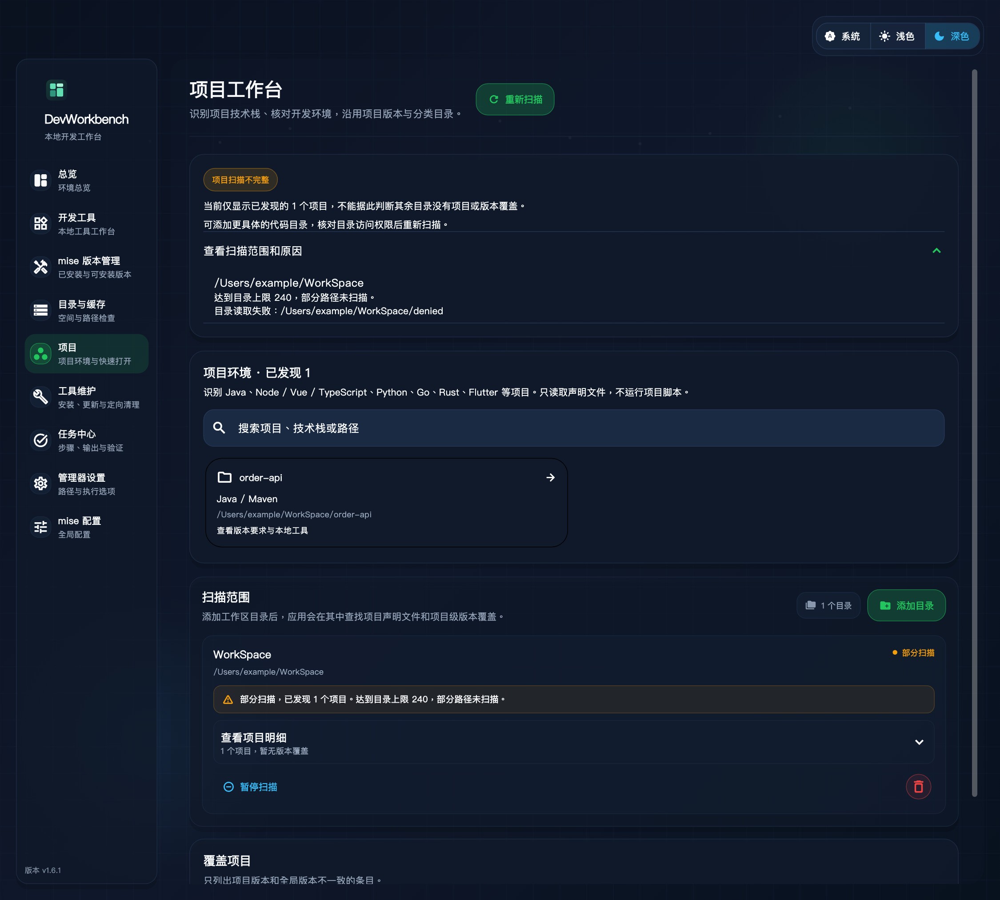

# DevWorkbench 1.6.1 稳定性修复

对应 [1.6.0 功能验收](feature-audit-2026-10-19.md)，版本 1.6.1（build 17），2026-10-19，macOS ARM64。沿用 Flutter 3.47.7，不新增 SDK 或调整用户的版本默认值。

## 修复

- Java `1.8` 旧编号转换限定于 Java 及完整数字段，Go、Rust 和其他语言按其数值版本比较。Rust 1.99.0 满足最低 1.85，Rust 1.85.0 不满足最低 1.90，Go 1.27.2 满足最低 1.8。
- 项目覆盖与工具档案共用正式 TOML 解析，行尾注释、单双引号、inline table、嵌套 version 不再产生虚假的版本覆盖。Rust channel 也按 TOML 读取。解析失败保留项目和警告；全局配置异常不再使所有项目消失。
- 本机工具探测 unavailable／attention 状态继续显示待核对，不误报未安装，也不因保留了旧版本就标为可用。
- 扫描结果携带每个根目录的访问计数、已发现项目数、完整性和原因。目录／项目上限、深度边界、读取失败都保留部分结果；失败的根不抹掉其他根。根目录重叠去重后，子目录沿用覆盖它的扫描状态。
- 项目页顶部、根目录卡片、空结果、刷新反馈及总览均反映部分扫描；详情可展开原因。已完成扫描不再一直显示“扫描中”。全局来源支持当前分类配置目录，Homebrew 设置文案说明已接入原生维护，空结果改称项目声明文件。

完整性表示本次发现范围是否完整，不等于项目依赖、构建或测试通过。忽略的依赖／产物目录不算遗漏；项目数量恰好达到上限且无剩余目录可报告完成。具体契约见 [项目工作台](projects.md)。

## 验证

- 修复前执行现有审计脚本，6 个断言失败；修复后原用例和新增的 3 个扫描范围断言全部通过，退出码 0。
- 新增 27 项回归：跨语言版本矩阵、探测状态、TOML 语义一致性、目录／项目／深度上限、空结果、禁用根、缺失与读取失败、全局解析失败、嵌套根归属、分类配置来源，以及宽／窄窗口下的扫描原因提示。
- 全套 218 项测试通过，两个显式本机验收在常规测试中跳过；静态分析与格式检查通过。真实 mise 注册、项目切换和未知 TOML 段保留测试继续使用隔离目录。
- 显式运行只读维护验收通过：76 个原生安装记录，wget 卸载及四类缓存预览；没有执行本机维护。工具清单仍识别 45/46 项，六类运行时的 8 个 SDK 符合分类目录，默认选择一致。
- 实际扫描源码父目录：发现 1 个 Node.js／Flutter 项目，访问 33 个目录，正确报告达到最大深度 3 的部分扫描。项目与工具的读取保持离线、禁止自动安装。
- Xcode 和 iOS SDK 实查均为 27.1；本轮 simctl 查询超时，未据此删除、替换或推断模拟器运行时。
- macOS Release 构建及严格签名检查通过；本地应用更新到 `/Applications/DevWorkbench.app` 1.6.1（build 17），全局与源码 AGENTS.md 同步。环境入口、mise 全局配置、管理器设置、项目扫描根和导入清单保留。

项目页预览使用实际 Flutter 页面及隔离夹具，不是用户目录的实机截屏：



重现：

```sh
mise exec -- flutter test --no-pub test/stability_161_test.dart test/project_environment_page_test.dart
mise exec -- dart run tool/audit_project_environment.dart
mise exec -- dart run tool/check_projects.dart --scan /path/to/code
```

生成图片时设置 `DEVWORKBENCH_RENDER_PROJECTS=1` 及 [字体变量](design/README.md)，运行项目页面测试中名称含 `partial scan` 的用例。
